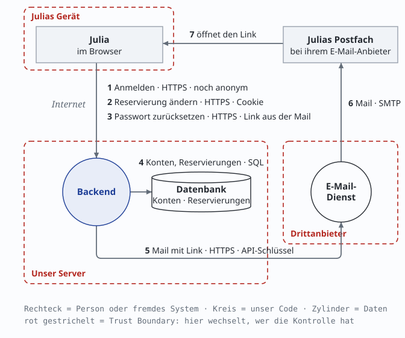
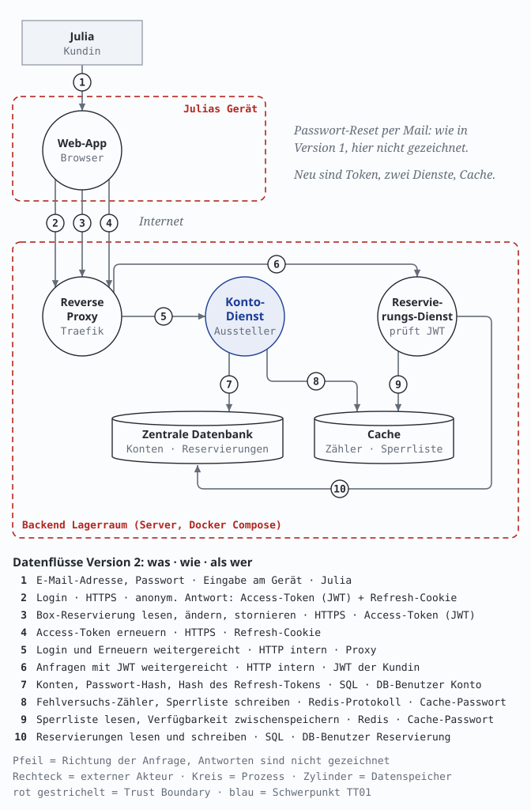

# Threat Model: Benutzerkonto und Login

Erste Version zur Besprechung. Benotet werden vier Kriterien: Systemdarstellung, Bedrohungen der Vertiefung, Priorisierung und Maßnahmen. Seitenangaben wie «V3 p. 182» beziehen sich auf den Foliensatz der Vorlesung.

Zum Vorführen gibt es eine [interaktive Fassung des Diagramms](threat-model-interactive.html) (zoomen, einen Fluss verfolgen). Sie ist eine Hilfe für den Vortrag; das Datenflussdiagramm unten ist die massgebliche Darstellung.

> **Draft, not yet the group's model**  
> This version was drafted with AI help on 2026-11-23 and then checked by two AI reviewers (see AI use). The lecturer is explicit: "Ein Dokument, das eine KI geschrieben hat, besteht kein Fachgespräch" (V3 p. 21). Before it is shown, the group has to check every component against what we really plan to build, strike what does not fit, and add what is missing. The architecture below is an assumption for the first iteration: the UX prototype has no backend and only a demo sign-in without a password.

## Vertiefung
**TT01 Benutzerkonten & Login**: "Nutzer müssen sich anmelden und können ihr Passwort zurücksetzen." (V3 p. 22)

Why this one: the Lagerraum app lets a customer reserve, change and cancel a storage box. Whoever gets into the account can cancel the box shortly before moving day. That gives the model a concrete damage and special cases of our own product (reset, shared device, reservation made without an account).

Open: the group has not confirmed the choice. TT07 (external interfaces) would also fit, because the app calls the volume API from the CI/CD part.

## 1. Woran arbeiten wir? (V3 p. 167, 170)

**Feature in einem Satz:** Julia meldet sich mit E-Mail-Adresse und Passwort an, um ihre Box-Reservierung zu sehen, zu ändern oder zu stornieren, und kann ihr Passwort über einen Link per E-Mail zurücksetzen.

**Schutzgüter**
- Die Reservierung selbst: Box, Zeitraum, das Recht zu ändern und zu stornieren.
- Kontaktdaten und Adresse.
- Passwort-Hash, Sitzung (Session-Cookie), Einmal-Token für Reset und Bestätigung.
- Die Zuordnung Reservierung zu Konto.

**Wer hätte Interesse daran?**
- Angreifer aus dem Internet mit Listen geleakter Zugangsdaten. Ausgangsposition: nur die Login-Seite.
- Eine Person aus Julias Umfeld mit Zugriff auf ihr Postfach oder ein gemeinsames Gerät (in der Persona: Jonas, von dem sie sich gerade trennt).
- Die nächste Person am geteilten Rechner im Pausenraum.

**Architektur der ersten Version (Annahmen)**
- Eine Web-App im Browser, ein Backend (Java-App), eine zentrale Datenbank. Konten, Sitzungen und Reservierungen liegen in derselben Datenbank, es gibt keine getrennten Dienste.
- Vor dem Backend steht der Reverse Proxy aus dem CI/CD-Teil (Traefik). TLS endet dort, dahinter läuft HTTP auf demselben Server.
- Mails verschickt ein externer E-Mail-Dienst. Welcher, ist offen.
- Reservieren geht auch ohne Konto (Produktentscheidung aus dem UX-Teil). Legt Julia später ein Konto mit derselben E-Mail-Adresse an, wird die Reservierung zugeordnet. Diese Regel ist eine Annahme und der Einstieg für T3.
- Es gibt in der ersten Version kein Admin-Tool für den Support, keinen eigenen Audit-Log-Speicher, kein «Angemeldet bleiben» und kein «Gerät merken».

**Nicht im Scope** (eigene Threat Models, V3 p. 168: nur die Vertiefung, dafür in der Tiefe)
- Der Box-Check selbst und die Volumen-API.
- Zahlung und Zugangscode zur Box.
- Rollen und Rechte zwischen mehreren Nutzern (wäre TT02), Support-Zugriff auf Konten.
- Betrieb: Portainer, Registry und CI/CD. Portainer steuert Docker und ist damit der mächtigste Weg ans Backend, gehört aber in ein eigenes Modell.
- Allgemeine Web-Schwachstellen wie XSS oder SQL Injection, die Framework und Infrastruktur abdecken, die Lieferkette der Bibliotheken und die Übernahme des Servers selbst.

## 2. Datenflussdiagramm

*Figure: Datenflüsse und Trust Boundaries für Konto und Login, Version 1. Rechteck = externer Akteur, Kreis = Prozess, Zylinder = Datenspeicher, rot gestrichelt = Trust Boundary (V3 p. 172; der Kreis ist die übliche DFD-Form für das Oval der Folie). Jeder Pfeil ist nummeriert; Daten, Protokoll und Identität stehen in der Liste im Bild.*

**Warum verläuft die Trust Boundary genau hier?** (Review-Frage, V3 p. 187)

| Trust Boundary | Begründung |
|---|---|
| Julias Gerät | Das Gerät kontrolliert Julia, nicht wir. Es kann geteilt sein (Rechner im Pausenraum) oder in fremde Hände kommen. Alles, was von dort kommt, ist ungeprüfte Eingabe. |
| Backend Lagerraum (Server, Docker Compose) | Ab dem Reverse Proxy kontrollieren wir. Jede Anfrage wird hier authentifiziert, autorisiert, validiert und protokolliert (V3 p. 173). Proxy, Backend und Datenbank laufen auf einem Server unter einem Betreiber, deshalb liegt zwischen ihnen keine weitere Grenze. Der unverschlüsselte Verkehr dort ist ein benanntes Restrisiko. |
| Drittanbieter (E-Mail-Dienst) | Fremder Betreiber, der unsere Mails samt Link sieht. Wir vertrauen ihm den Versand an, prüfen aber nicht, was er speichert. |
| ohne Kasten: Julias Postfach | Liegt bei ihrem E-Mail-Anbieter und ausserhalb jeder Kontrolle von uns. Wer das Postfach liest, wissen wir nicht. Deshalb gelten Links nur kurz und einmal (T2). |

Fluss 5 kreuzt keine Grenze. Wir betrachten ihn trotzdem (T6), weil das Backend dort einem Wert vertraut, den der Proxy weiterreicht. Fluss 1 hat keine eigene Bedrohung; ein leeres Feld ist ein gültiges Ergebnis (V3 p. 176).

## 3. Was kann schiefgehen? Was tun wir dagegen?

STRIDE an jedem Fluss, der eine Grenze kreuzt (V3 p. 176). Jede Bedrohung in der Form: wer kann was an welchem Fluss tun, weil welche Schwäche besteht, mit welcher Auswirkung (V3 p. 177).

**Skala** (selbst gewählt, V3 p. 179). Bewertet wird das Risiko vor der Maßnahme.
- **Hoch:** aus dem Internet ohne Zugang zu Gerät oder Postfach ausnutzbar und automatisierbar, und die Folge ist eine übernommene, gelesene oder stornierte Reservierung, oder es trifft viele Konten.
- **Mittel:** braucht eine Vorbedingung (Zugriff auf Gerät, Postfach, Sitzung oder Datenbank) und trifft ein Konto, oder es hebelt eine andere Maßnahme aus.
- **Niedrig:** kein direkter Schaden an der Reservierung, oder schnell umkehrbar.

| ID | Fluss | STRIDE | Bedrohung | Priorität und Begründung | Maßnahme (wo, wer) | Status |
|---|---|---|---|---|---|---|
| T1 | 2 | S | Ein Angreifer aus dem Internet probiert bei Fluss 2 automatisiert geleakte Paare aus E-Mail-Adresse und Passwort durch, weil der Login Fehlversuche nicht begrenzt, und übernimmt Konten mit wiederverwendetem Passwort. | **Hoch.** Aus dem Internet, ohne Vorwissen, automatisierbar. Folge: Adresse einsehbar, Box kurz vor dem Umzug storniert. | Fehlversuche je Kombination aus Konto und IP mit steigender Wartezeit verzögern, keine harte Sperre (siehe T8); zusätzlich Fehlversuche je IP über viele verschiedene Konten zählen, mit hohem Schwellwert, weil hinter einer Adresse mehrere Personen sitzen können; neues Passwort nach Länge (mindestens 12 Zeichen) und gegen eine lokal mitgelieferte Liste häufiger und geleakter Passwörter prüfen; Mail an Julia bei Passwortänderung und Reset. Backend, Backend-Team. | offen |
| T2 | 4 | S | Ein Angreifer aus dem Internet errät bei Fluss 4 einen Reset-Token oder löst einen alten, schon benutzten Token noch einmal ein, weil Token vorhersagbar erzeugt werden, lange gelten oder mehrfach einlösbar sind, und setzt für ein fremdes Konto ein Passwort seiner Wahl, ohne das Postfach zu kennen. | **Hoch.** Aus dem Internet ohne Vorwissen und automatisierbar; ein vorhersagbarer Token träfe alle Konten. Folge: vollständige Kontoübernahme. | Token aus kryptografischem Zufall (32 Byte), nur als Hash in der Datenbank, 15 Minuten gültig, einmal einlösbar (V3 p. 90-92); ein neuer Reset-Antrag macht ältere Token ungültig; der Aufruf des Links zeigt nur das Formular, verbraucht wird der Token erst beim Absenden. Backend, Backend-Team. | offen |
| T3 | 2 | S, I | Ein Angreifer aus dem Internet legt bei Fluss 2 mit Julias E-Mail-Adresse ein Konto an, bevor sie selbst eines anlegt, weil die Adresse nicht bestätigt werden muss und eine Reservierung ohne Konto allein über die Adresse zugeordnet wird, und sieht danach ihre Reservierung samt Kontaktdaten und kann sie stornieren. | **Hoch.** Aus dem Internet ohne Zugang und automatisierbar: Adressen aus Leaklisten lassen sich vorab massenhaft registrieren, und jede spätere Reservierung ohne Konto mit so einer Adresse fällt dem Angreifer zu. | Ein Konto wird erst nutzbar, wenn die Adresse über einen Link in der Bestätigungsmail bestätigt ist; Reservierungen ohne Konto werden nur nach dieser Bestätigung verknüpft. Backend, Backend-Team. | offen |
| T4 | 3 | S | Die nächste Person am geteilten Rechner im Pausenraum handelt bei Fluss 3 als Julia, weil die Sitzung nach dem Verlassen der Seite auf dem Server gültig bleibt und Tab oder Browser schliessen sie nicht beendet, und ändert oder storniert die Reservierung. | **Mittel.** Braucht physischen Zugang zum selben Gerät und trifft ein Konto. Folge ist trotzdem ein Storno. | Sitzung läuft nach 15 Minuten ohne Aktivität und spätestens nach 8 Stunden ab; «Abmelden» auf jedem Screen sichtbar; Seiten nach dem Login dürfen nicht im Browser-Cache bleiben, damit «Zurück» nach dem Abmelden nichts zeigt; vor Stornieren, Konto löschen und E-Mail-Adresse ändern erneut das Passwort abfragen. Backend und Web-App, Backend- und Frontend-Team. | offen |
| T5 | 4, 8 | S | Eine Person mit Zugriff auf Julias Postfach (zum Beispiel auf einem entsperrten oder geteilten Gerät) fordert bei Fluss 4 einen Reset an, liest den Link aus der Mail (Fluss 8) und übernimmt das Konto, weil der Besitz des Postfachs der einzige Nachweis ist. | **Mittel.** Braucht Zugriff auf das Postfach, nicht automatisierbar, ein Konto. Folge: Storno durch jemanden mit persönlichem Motiv. | Nach jedem Reset alle Sitzungen beenden; Stornieren umkehrbar machen: Die Box bleibt 48 Stunden «storniert, wiederherstellbar»; eine neue E-Mail-Adresse wird nach einem Reset erst nach 24 Stunden wirksam (T11). Eine Benachrichtigung per Mail hilft hier nicht, weil sie im selben Postfach landet. Backend, Backend-Team. Restrisiko siehe unten. | offen |
| T6 | 2 über 5 | S, T | Ein Angreifer aus dem Internet umgeht bei Fluss 2 die Begrenzung aus T1, indem er bei jeder Anfrage eine andere Absender-IP in einen Weiterleitungs-Header schreibt, weil das Backend die IP aus diesem Header liest und der Proxy ihn ungeprüft über Fluss 5 durchreicht. | **Mittel.** Richtet allein keinen Schaden an, hebelt aber die Maßnahme gegen T1 aus. | Das Backend vertraut Weiterleitungs-Headern nur vom Proxy und nutzt den vom Proxy gesetzten Wert; das Backend hat keinen nach aussen veröffentlichten Port. Vor dem Einbau prüfen, wie Traefik mit solchen Headern umgeht und ob das Backend im Compose-Setup die echte Absender-IP sieht (nicht geprüft). Proxy-Konfiguration und Docker Compose, wer den CI/CD-Teil betreut. | offen |
| T10 | 3 | S, I | Ein Angreifer, der Julias Session-Cookie aus dem Browserprofil eines geteilten Geräts kopiert, nutzt bei Fluss 3 ihre Sitzung auf einem anderen Gerät weiter, weil die Sitzung nicht widerrufen wird, und ändert oder storniert die Reservierung, ohne dass Julia es merkt. | **Mittel.** Braucht Zugriff auf das Browserprofil und trifft ein Konto. Anders als bei T4 handelt der Angreifer später und von woanders. | Sitzungs-ID aus Zufall, nur in der Datenbank gespeichert und dort löschbar; Cookie nur über HTTPS und für Skripte nicht lesbar; neue Sitzungs-ID bei Login und Reset; Abmelden und Passwortänderung beenden alle Sitzungen. Backend und Proxy, Backend-Team und wer den CI/CD-Teil betreut. | offen |
| T11 | 3 | S | Ein Angreifer mit kurzem Zugriff auf Julias Sitzung (T4, T10) ändert bei Fluss 3 die E-Mail-Adresse des Kontos auf seine eigene, weil die Änderung sofort gilt und die alte Adresse nichts erfährt, und kontrolliert danach jeden Reset und damit das Konto dauerhaft. | **Mittel.** Braucht eine offene oder gestohlene Sitzung und trifft ein Konto, die Folge ist aber dauerhaft: Der Reset als Rückweg führt dann zum Angreifer. | Die neue Adresse gilt erst nach einem Bestätigungslink an die neue Adresse; an die alte Adresse geht eine Mail mit «Das war ich nicht», die die Änderung rückgängig macht und alle Sitzungen beendet; vorher Passwort erneut abfragen. Backend, Backend-Team. | offen |
| T12 | 6 | I | Ein Angreifer mit einem Abzug der Datenbank (Backup, Dump) knackt die Passwort-Hashes aus Fluss 6 offline, weil sie mit einem schnellen Verfahren oder ohne Salt gespeichert sind, und übernimmt Konten bei uns und bei anderen Diensten, auf denen Kundinnen dasselbe Passwort nutzen. | **Mittel.** Braucht vorher Zugriff auf die Datenbank, trifft dann aber alle Konten und lässt sich nicht zurückholen. | Passwörter mit Argon2id und eigenem Salt je Konto speichern, nie mit MD5 oder SHA (V3 p. 93-94); Parameter in der Konfiguration, damit sie später erhöht werden können. Backend, Backend-Team. | offen |
| T7 | 2, 4 | I | Ein Angreifer findet bei Fluss 2 und 4 heraus, welche E-Mail-Adressen Kundinnen sind, weil Registrierung, Login und Reset bei bekannten und unbekannten Adressen verschieden antworten, und gewinnt eine Zielliste für T1 und T3. | **Niedrig.** Allein kein Schaden an einer Reservierung. | In allen drei Formularen dieselbe Antwort («Wenn es ein Konto gibt, ist eine Mail unterwegs»); die Mail wird nach der Antwort versendet, damit die Antwortzeit gleich bleibt. Backend, Backend-Team. | offen |
| T8 | 2 | D | Jemand sperrt Julia kurz vor dem Umzugstag gezielt aus, indem er bei Fluss 2 absichtlich falsche Passwörter eingibt, weil eine Sperre am Konto hängt. | **Niedrig.** Lästig, aber der Reset per Mail bleibt möglich und die Reservierung bleibt bestehen. | Verzögerung statt Sperre, Zähler je Kombination aus Konto und IP wie in T1. Backend, Backend-Team. | offen |
| T9 | 3 | R | Julia bestreitet bei Fluss 3 eine Stornierung, und wir können nicht zeigen, wann sich wer angemeldet, das Passwort oder die E-Mail-Adresse geändert oder storniert hat, weil diese Ereignisse nicht festgehalten werden. | **Niedrig.** Kein direkter Schaden, erschwert aber die Klärung der anderen Fälle. | Für die erste Version: eine Zeile im Anwendungs-Log je Login, Fehlversuch, Reset, E-Mail-Änderung und Storno (Zeitpunkt, Konto, IP), gesammelt über den vorhandenen Logging-Stack aus dem CI/CD-Teil; nie Passwörter, Token oder ganze Reset-Links ins Log schreiben; Mail an Julia bei Reset, E-Mail-Änderung und Storno. Kein eigener Audit-Speicher. Backend, Backend-Team. | offen |

STRIDE: S (T1 bis T6, T10, T11), T (T6), R (T9), I (T3, T7, T10, T12), D (T8). E: keine eigene Bedrohung, weil Rollen und Rechte zwischen Nutzern ausserhalb des Scopes liegen (TT02).

**Warum steht X vor Y?**
- T1 bis T3 vor allen anderen: Sie gehen aus dem Internet, ohne Vorbedingung und in grosser Zahl. Untereinander sind sie gleich hoch.
- T3 gleich hoch wie T1: ebenfalls automatisierbar, weil Adressen vorab registriert werden können, und wir schaffen die Lücke selbst durch Reservieren ohne Konto (Persona: keine Pflichtregistrierung).
- T4, T5, T10, T11, T12 sind Mittel, weil sie Nähe zu Julia, eine offene Sitzung oder die Datenbank brauchen. T11 und T12 stehen dort trotz dauerhafter Folge, weil die Vorbedingung hoch ist.
- T6 ist Mittel, obwohl aus dem Internet: Es schadet nicht selbst, sondern macht T1 wieder möglich.
- T7 bis T9 sind Niedrig: Sie verraten, stören oder erschweren die Klärung, ändern aber keine Reservierung.

**Verworfene Alternativen** (Review-Frage «Welche Alternative habt ihr verworfen, und warum?», V3 p. 187). Vorschläge, im Team prüfen:
- Zweiter Faktor für alle (zu T1): verworfen für die erste Version. Mehr Reibung für Julia im Nachtdienst, und der Verlust des zweiten Geräts braucht einen eigenen Rückweg.
- Login nur per Mail-Link (zu T1, T5): verworfen. Es verschiebt T1 nach T5, weil dann das Postfach allein das Konto ist.
- Storno nach einem Reset 24 Stunden sperren (zu T5): verworfen. Es trifft Julia bei einem echten Reset, und der Angreifer wartet einfach. Stattdessen ist das Storno umkehrbar.
- Harte Kontosperre nach Fehlversuchen (zu T8): verworfen, weil sie gezieltes Aussperren vor dem Umzugstag möglich macht.
- Reservieren nur mit Konto (zu T3): verworfen. Produktentscheidung, die Persona will keine Pflichtregistrierung.

**Akzeptierte Risiken** (bewusst, begründet, mit Verantwortlichem, V3 p. 180). Verantwortliche sind noch nicht benannt.
- Wer dauerhaft Zugriff auf Julias Postfach hat, kann das Konto übernehmen (Rest von T5). Das Postfach liegt ausserhalb unserer Kontrolle. Wir senken die Folgen (umkehrbares Storno, verzögerte E-Mail-Änderung), verhindern es aber nicht.
- Kein manipulationssicheres Audit-Log in der ersten Version (Rest von T9). Wer Zugriff auf den Server hat, könnte Log-Zeilen löschen.
- TLS endet am Reverse Proxy; zwischen Proxy, Backend und Datenbank laufen HTTP und SQL unverschlüsselt auf demselben Server. Vertretbar, wenn Proxy und Backend ein eigenes Netz bekommen und nur der Proxy Ports veröffentlicht.
- E-Mail ist kein vertraulicher Kanal: Links sind auf dem Weg zum Postfach nicht durchgehend geschützt (Fluss 8). Begrenzt durch 15 Minuten Gültigkeit und Einmal-Einlösung (T2).
- Schadsoftware auf Julias eigenem Gerät betrachten wir nicht. Sie hebelt jede Kontrolle der Web-App aus; die Abwehr liegt beim Gerät.

## 4. Haben wir es gut gemacht? Offene Punkte für das Review

Selbst-Check (V3 p. 182), ehrlich ausgefüllt:

| Kriterium | Stand |
|---|---|
| Systemdarstellung, 7 P. | Produkt erkennbar (Box-Reservierung, Storno, Reservieren ohne Konto). Jeder der neun Pfeile nennt Daten, Protokoll, Identität. Offen: Die Architektur ist eine Annahme, bis das Backend geplant ist. |
| Bedrohungen der Vertiefung, 9 P. | Jede Bedrohung hängt an einem Fluss, der eine Grenze kreuzt, und nennt Angreifer und Wirkung. Sonderfälle dabei: Reset, geteiltes Gerät, Reservierung ohne Konto, E-Mail-Änderung. Offen: siehe Kandidaten unten. |
| Priorisierung, 6 P. | Jede Stufe hat einen Satz Begründung, die Skala steht oben und gilt vor der Maßnahme. Offen: im Team prüfen, ob wir T3 wirklich so hoch sehen. |
| Maßnahmen, 8 P. | Je Bedrohung eine Maßnahme mit Ort und Zuständigkeit. Offen: Niemand ist namentlich verantwortlich, alle Status sind «offen», weil nichts gebaut ist. |

Kandidaten, die ein Reviewer noch nennen könnte und die wir bewusst noch nicht aufgenommen haben:
- **Wo liegen die Secrets?** API-Schlüssel des E-Mail-Dienstes und DB-Passwort (Fluss 7 und 6). Die Folie fragt danach (V3 p. 171, Frage 2), unsere Architektur beantwortet es noch nicht. Sie dürfen nicht im Repository stehen.
- **Massenhaft ausgelöste Mails** über Registrierung und Reset (Fluss 2 und 4 nach 7): erschöpft das Kontingent des Mail-Dienstes und nimmt Julia den Reset als Rückweg.
- **Der Reset-Link selbst** landet in Logs des Proxys oder wird von einem Mail-Scanner vorab aufgerufen. Teilweise durch T2 gedeckt (Token wird erst beim Absenden verbraucht).

Fragen, die wir im Review erwarten (V3 p. 187), und wo die Antwort steht:
- Warum verläuft die Trust Boundary genau hier? Tabelle in Abschnitt 2.
- Was passiert, wenn dieses Token gestohlen wird? Reset-Token: T2. Session-Cookie: T10.
- Warum ist dieser Threat Hoch und jener nur Mittel? «Warum steht X vor Y».
- Welche Alternative habt ihr verworfen? «Verworfene Alternativen».
- Was habt ihr bewusst nicht betrachtet? «Nicht im Scope» und «Akzeptierte Risiken».

## 5. Ausblick: Version 2

Not part of the first submission. It shows where the model changes once the app grows: tokens (JWT) instead of server sessions, two services behind the proxy, and a cache. Only what is new or changes is drawn (V3 p. 168: "nur Datenflüsse, die neu sind oder sich ändern"); the password reset by mail stays as in version 1.

*Figure: Ausblick Version 2. Der Konto-Dienst stellt ein kurzlebiges Access-Token (JWT) und ein Refresh-Cookie aus, der Reservierungs-Dienst prüft das Token selbst. Ein Cache hält Fehlversuchs-Zähler, die Sperrliste widerrufener Token und die Verfügbarkeit der Boxen.*

**Warum überhaupt diese Änderungen?**
- **Zwei Dienste:** Konto und Reservierung lassen sich getrennt ausliefern und skalieren. Der Reservierungs-Dienst braucht dann einen Weg, die Anmeldung zu prüfen, ohne bei jeder Anfrage den Konto-Dienst zu fragen.
- **JWT:** genau dieser Weg. Der Reservierungs-Dienst prüft nur die Signatur. Der Preis: Ein ausgestelltes Token lässt sich nicht einfach zurückziehen.
- **Cache:** Zähler aus T1 und eine Sperrliste müssen schnell und für beide Dienste erreichbar sein. Dazu die Verfügbarkeit der Boxen, damit die Startseite nicht bei jedem Aufruf die Datenbank fragt.

Was sich gegenüber Version 1 ändert: T4 und T10 (Sitzung) werden zu V1, V2 und V5. Die Trust Boundaries bleiben gleich; im Backend kommt keine neue Grenze dazu, aber zwei Dienste müssen einander und dem Cache vertrauen.

| ID | Fluss | STRIDE | Bedrohung | Priorität und Begründung | Maßnahme (wo, wer) |
|---|---|---|---|---|---|
| V1 | 3 | S | Ein Angreifer mit einem kopierten Access-Token handelt bei Fluss 3 weiter als Julia, auch nachdem sie sich abgemeldet oder ihr Passwort geändert hat, weil der Reservierungs-Dienst nur die Signatur prüft und das Token bis zum Ablauf gilt. | **Mittel.** Braucht ein gestohlenes Token und trifft ein Konto; neu ist, dass Abmelden allein nicht mehr hilft. | Access-Token höchstens 15 Minuten gültig; bei Abmelden, Reset und Passwortänderung kommt die Token-ID auf die Sperrliste im Cache; vor Stornieren prüft der Dienst die Sperrliste. Konto-Dienst und Reservierungs-Dienst. |
| V2 | 2, 3 | I | Ein in die Seite eingeschleustes Skript liest das Access-Token aus dem Speicher des Browsers, weil die Web-App es dauerhaft dort ablegt, und schickt es an einen Angreifer. | **Mittel.** Braucht eine zweite Schwäche in der Web-App, trifft dann aber jede Kundin, die die Seite öffnet. | Access-Token nur im Arbeitsspeicher der Seite halten, nicht dauerhaft speichern; das Refresh-Token liegt in einem Cookie, das Skripte nicht lesen können. Web-App, Frontend-Team. |
| V3 | 6 | S, E | Ein Angreifer baut sich selbst ein Token mit Julias Konto-ID und schickt es über Fluss 3 und 6, weil der Reservierungs-Dienst den Algorithmus aus dem Token übernimmt oder Aussteller und Empfänger nicht prüft, und handelt als beliebige Kundin. | **Hoch.** Aus dem Internet, ohne Vorwissen, automatisierbar, trifft alle Konten. | Algorithmus fest vorgeben, Aussteller, Empfänger und Ablauf prüfen, eine bewährte Bibliothek statt eigener Prüfung (V3 p. 129-131). Reservierungs-Dienst, Backend-Team. |
| V4 | 5, 6 | S | Wer den Signierschlüssel des Konto-Dienstes liest (Repository, Compose-Datei, CI-Log), stellt gültige Token für jedes Konto aus, weil derselbe geheime Schlüssel in beiden Diensten liegt. | **Mittel.** Braucht Zugriff auf Repository oder Server, trifft dann aber alle Konten. | Asymmetrisch signieren: Der private Schlüssel liegt nur beim Konto-Dienst, der Reservierungs-Dienst kennt nur den öffentlichen; Schlüssel nicht im Repository; Wechsel des Schlüssels mit Schlüssel-ID im Token vorsehen. Wer den CI/CD-Teil betreut. |
| V5 | 4 | S | Ein Angreifer mit einem kopierten Refresh-Cookie holt sich bei Fluss 4 immer neue Access-Token, weil das Refresh-Token lange gilt und beliebig oft verwendbar ist, und bleibt wochenlang angemeldet. | **Mittel.** Braucht Zugriff auf das Browserprofil, hält dann aber viel länger als ein Access-Token. | Refresh-Token bei jeder Verwendung austauschen; taucht ein altes noch einmal auf, alle Token dieses Kontos sperren und Julia benachrichtigen; in der Datenbank steht nur der Hash. Konto-Dienst, Backend-Team. |
| V6 | 8, 9 | S, D | Fällt der Cache aus, lässt der Reservierungs-Dienst gesperrte Token wieder durch und die Zähler aus T1 beginnen bei null, weil die Dienste bei einem Fehler des Caches «im Zweifel erlauben». Ein Angreifer kann den Ausfall auch herbeiführen. | **Mittel.** Hebelt V1 und T1 aus, solange der Cache fehlt. | Bei Cache-Ausfall Stornieren und Ändern ablehnen, Lesen weiter erlauben (V3 p. 142-143: im Zweifel ablehnen); Ausfall alarmieren. Beide Dienste, Backend-Team. |
| V7 | 8, 9 | T | Ein anderer Container im selben Netz löscht die Sperrliste oder setzt Zähler zurück, weil der Cache ohne Passwort erreichbar ist, und macht damit gesperrte Token wieder gültig. | **Mittel.** Braucht einen Fuss im Server, hebelt dann V1 und T1 aus. | Cache nur im Netz der beiden Dienste, mit Passwort, ohne veröffentlichten Port. Docker Compose, wer den CI/CD-Teil betreut. |
| V8 | 9, 10 | T | Zwei Kundinnen reservieren dieselbe Box, weil der Reservierungs-Dienst die Verfügbarkeit aus dem Cache liest und der Eintrag veraltet ist. Mit Absicht ausgelöst, blockiert jemand so Boxen für andere. | **Niedrig.** Kein Zugriff auf fremde Daten, aber ein falsches Versprechen an die Kundin. | Der Cache dient nur der Anzeige; beim Reservieren entscheidet die Datenbank in einer Transaktion. Reservierungs-Dienst, Backend-Team. |
| V9 | 3 | I | Wer ein Token mitliest oder in einem Log findet, liest darin Julias E-Mail-Adresse und Namen, weil das Token nur signiert und nicht verschlüsselt ist und diese Angaben enthält. | **Niedrig.** Kein Zugriff auf das Konto, nur Preisgabe von Kontaktdaten. | Im Token stehen nur Konto-ID, Ablauf und Token-ID. Konto-Dienst, Backend-Team. |

**Was sonst für Version 2 sinnvoll wäre** (ohne eigenes Diagramm):
- **Zweiter Faktor oder Passkeys** für Stornieren und E-Mail-Änderung. Beantwortet T1 und T5 besser als jede Verzögerung.
- **Support-Werkzeug mit eigener Rolle.** Bringt die Frage zurück, wer ausser Julia an ein Konto kommt, und gehört zu TT02 (Rollen).
- **Tabelle für Sicherheitsereignisse** in der Datenbank statt Zeilen im Log. Schliesst das akzeptierte Risiko aus T9.
- **Anmeldung über einen geprüften Dienst** (zum Beispiel ein Identity Provider). Das wäre «Transferieren» (V3 p. 180): Passwort und Reset liegen dann nicht mehr bei uns, dafür hängt der Login von einem Dritten ab.
- **Begrenzung ausgelöster Mails** je Adresse und insgesamt, sobald echte Kundinnen die App nutzen.

## Next
- Group review: confirm TT01, check the architecture against what we plan to build
- Decide the open points (session mechanism, e-mail provider, database, where secrets live)
- Name an owner per measure and per accepted risk
- SDLC-Skizze, one slide: measures per phase and the security gates (no points, basis for the Fachgespräch; V3 p. 18)
- KI-Notiz: what we used, kept, discarded and corrected, each with a concrete example (V3 p. 181)
- Pick the one example for the 3-minute talk: threat, priority decision, measure (V3 p. 20)

## AI use
- 2026-11-23 · Claude (Claude Code) · read the V3 slide deck and extracted the method and the grading criteria; chose TT01 on the user's request to pick the easiest topic that still gives a detailed diagram; drafted the scope, the data flow diagram (SVG, generated by a script), the threats with priorities and measures, the self-check and the open points.
- 2026-11-23 · correction by the user · the first AI draft invented a separate account service with its own database, a support admin tool and an audit-log store. The user rejected these as unrealistic for a first iteration: one backend, one central database, no audit store. The diagram and the threats were redrawn accordingly; the support threat was dropped and T6 (forwarded-IP header) was added because the reverse proxy is now in the picture. Process shapes changed from ovals to circles on the user's request.
- 2026-11-23 · two AI reviewers (Claude subagents) · one checked the threats against the rubric, one the diagram. Kept from them: corrected flow numbers for T3, T6 and T9 (they pointed at flows inside the backend boundary); a scale that states the impact and applies before the measure; T5's 24-hour cancel lock replaced by a reversible cancellation because the lock would hit Julia herself; T10 to T12 added (session cookie, e-mail change, password hash); flow 9 numbered; legend row 5 corrected; boundary renamed from "Docker-Netz"; "SMTP mit TLS" weakened to "TLS nicht garantiert". Discarded: a separate table for security events (contradicts the decision against an audit store in version 1; moved to the outlook) and three further threats, listed as candidates instead of rows to keep the table readable. Not verified by anyone yet: how Traefik treats forwarded headers (T6).
- 2026-11-23 · Claude (Claude Code) · section 5 (outlook version 2 with JWT, two services and a cache) on the user's request, including its diagram and nine threats. Not reviewed.
