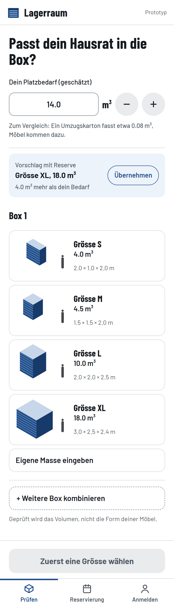
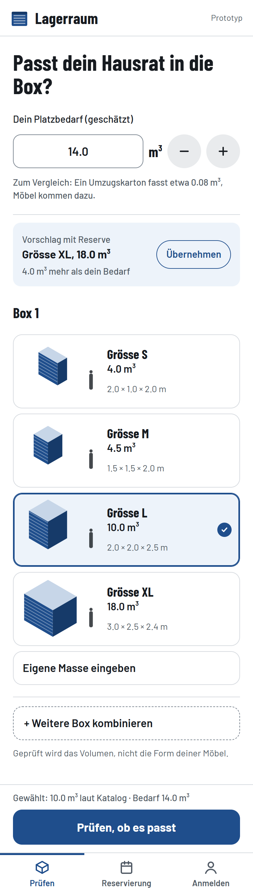
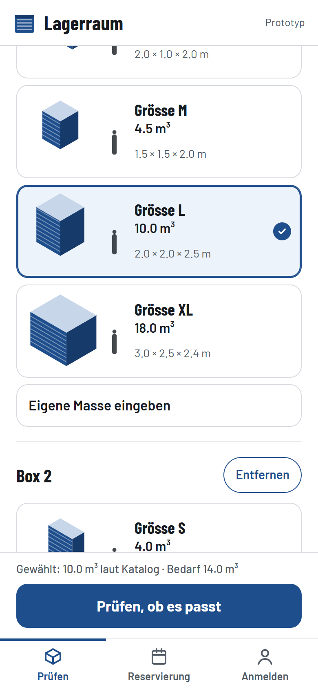
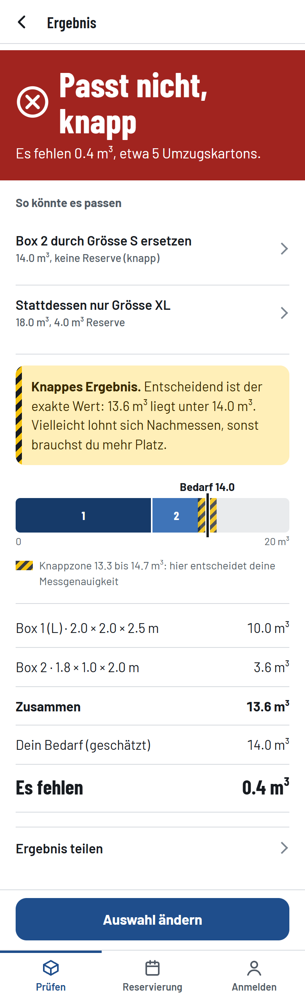
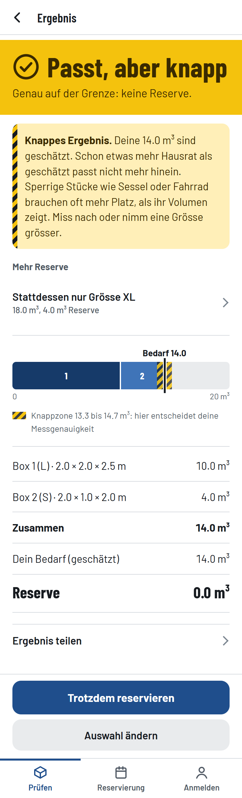
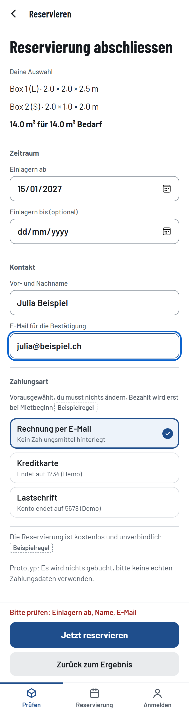
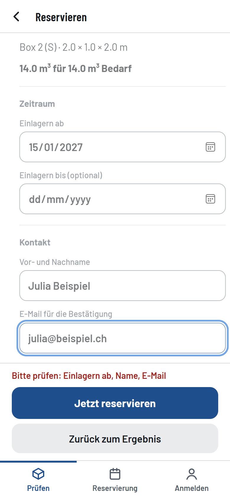
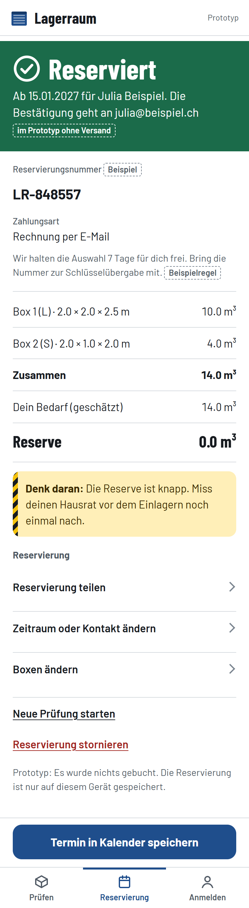
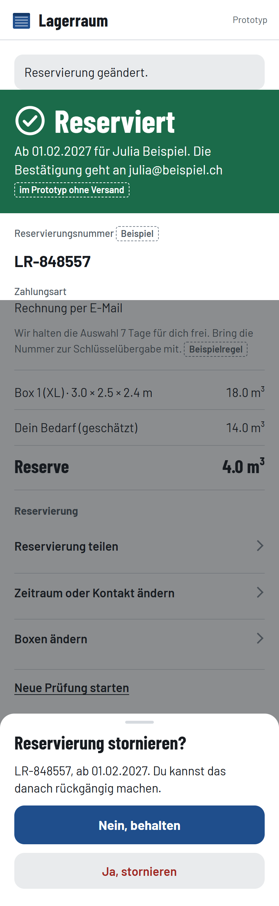
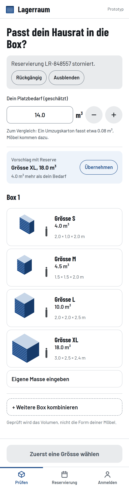

# Cognitive Walkthrough: Prototyp "Lagerraum Box-Check"

> **Status (23.11.2026):** Dies ist der eigene Cognitive Walkthrough des Teams, mit KI-Unterstützung entworfen. Er ist ein Experten-Urteil aus der Sicht der Persona und **kein Test mit echten Personen**. Alle Befunde sind Hypothesen, die das Team prüfen muss (Abschnitt "Offene Fragen für den Usability-Test" und [Testplan](../testplan/)).

## Hinweise zum Prototyp und zu den Screenshots

- **Abweichungen vom Fallsteckbrief:** Der Steckbrief setzt den Bedarf fest auf 14.0 m³ und spricht von 1 oder 2 Boxen. Der Prototyp lässt den Bedarf änderbar (Startwert 14.0 m³) und erlaubt bis zu vier Boxen. Der Grössenkatalog (S 4.0, M 4.5, L 10.0, XL 18.0 m³), das Konto, die Zahlungsarten, die Haltefrist und die Reservierungsnummer sind zugunsten des Realismus erfunden und in der Oberfläche als Beispiel markiert. Die Regel ist unverändert: Es passt, wenn die Summe mindestens 14.0 m³ beträgt; "knapp" gilt im Bereich von 13.3 bis 14.7 m³ (±0.7 m³).
- **Screenshots:** Handy-Breite (390 × 844 px). Die meisten Bilder sind Ganzseiten-Aufnahmen, bei denen Kopfzeile, untere Aktionsleiste und Tab-Leiste im Textfluss statt fixiert dargestellt sind. Im echten Prototyp bleiben diese drei Leisten am Bildschirmrand stehen. Die Bilder `03-zweite-box.png` und `06b-formular-ausschnitt.png` zeigen den echten Ausschnitt mit fixierten Leisten.
- **Methode:** (1) Persona und Ziel, (2) Aktionen eines zentralen Ablaufs, (3) vier Fragen je Schritt, (4) Befunde mit Hürde, Screen, kurzer Begründung und möglicher Folge.
- **Stand der Prüfung:** Alle Befunde stützen sich auf Screenshots. Die Befunde CW03, CW06, CW08 und CW09 wurden zusätzlich am laufenden Prototyp nachvollzogen. Es wurden keine Personen beobachtet.

## 1 Persona und Ziel

**Julia Brandt, 31** (fiktiv), Pflegefachfrau auf der Intensivstation mit Schichtdienst. Sie trennt sich nach sechs Jahren, muss bis Samstag, 31.10. aus der gemeinsamen Wohnung ausziehen, ihre neue Wohnung ist erst ab 15.12. frei. Ihr Hausrat ist von einer Spedition auf 14.0 m³ geschätzt; 0.7 m³ davon sind noch offen (Waschmaschine, Teppich, Stehlampe).

- **Vorwissen:** Erstmals Self-Storage. Sie kennt Umzugskartons, keine Kubikmeter (Raumvorstellung 1 von 5). Alltags-Apps ja, neue Konten und lange Formulare nein.
- **Gerät und Kontext:** Smartphone, meist einhändig, in Pausen von etwa 15 Minuten, oft nachts und müde. Unterbrechungen jederzeit.
- **Haltung:** Hoch motiviert, aber misstrauisch gegenüber Tools, die zur grösseren Box drängen. Sie will nicht mehr bezahlen als nötig.
- **Konkretes Ziel:** Mit einer Box oder zwei Boxen sicher wissen, dass die 14.0 m³ reichen, ein "knapp" verstehen und die passende Kombination ohne Pflichtkonto reservieren.

## 2 Nutzerablauf (Handlungsschritte)

Grundlage ist das Soll-Szenario der Fallstudie: Julia trägt eine zu kleine Box ein, sucht eine Lösung, versteht ein "knapp" und reserviert. Dazu kommt ein Schritt nach der Reservierung.

| Nr. | Handlungsschritt | Screen |
|---|---|---|
| 1 | Bedarf kontrollieren und die erste Box wählen (Grösse L, 10.0 m³), prüfen lassen | Start, Ergebnis "Passt nicht" |
| 2 | Eine zweite Box ergänzen und prüfen lassen (im Soll-Szenario mit eigenen Massen 1.8 × 1.0 × 2.0 m: 13.6 m³) | Start mit Box 2, Ergebnis "Passt nicht, knapp" |
| 3 | Das "knapp" verstehen und die Auswahl so anpassen, dass es passt | Ergebnis "Passt, aber knapp" |
| 4 | Reservieren: Zeitraum, Kontakt, Zahlungsart | Formular, "Reserviert" |
| 5 | Die Reservierung ändern (Datum) oder stornieren | Reservierungsdetail, Rückfrage, Start nach Storno |

Je Schritt gelten die vier Fragen: **F1** Ist das Ziel klar? **F2** Wird die passende Aktion erkannt? **F3** Ist sie verständlich? **F4** Ist die Rückmeldung erkennbar? Antworten: ja, teilweise, nein.

---

### Schritt 1: Bedarf kontrollieren, erste Box wählen, prüfen lassen

*Abb. 1: Start. Die Schaltfläche unten ist deaktiviert ("Zuerst eine Grösse wählen").*

*Abb. 2: Grösse L gewählt. Unten steht "Gewählt: 10.0 m³ laut Katalog · Bedarf 14.0 m³".*

| Frage | Antwort | Begründung |
|---|---|---|
| F1 Ziel klar? | ja | Die Überschrift "Passt dein Hausrat in die Box?" nennt Julias Frage, der Bedarf ist mit 14.0 m³ vorbelegt und der Umzugskarton-Vergleich ("Ein Umzugskarton fasst etwa 0.08 m³") hilft ihrer schwachen Raumvorstellung. |
| F2 Aktion erkannt? | teilweise | Die Grössenkarten sind klar, aber der Vorschlag "Grösse XL, 18.0 m³" mit "Übernehmen" steht noch vor jeder Eingabe und lenkt zur grössten Box (CW01). |
| F3 Verständlich? | teilweise | Neben jeder Karte steht eine kleine dunkle Figur, die wie ein "i" für Info aussieht und nicht beschriftet ist (CW02). |
| F4 Rückmeldung? | ja | Gewählte Karte mit Haken und Rahmen, dazu die Zeile "Gewählt: 10.0 m³ laut Katalog · Bedarf 14.0 m³"; ohne Auswahl sagt die Schaltfläche, was fehlt. |

### Schritt 2: Zweite Box ergänzen und prüfen lassen

Zuerst liefert die Prüfung mit nur einer Box L das Ergebnis "Passt nicht" mit "Es fehlen 4.0 m³, etwa 50 Umzugskartons." und der Liste "So könnte es passen" (u. a. "Grösse S dazunehmen"). Julia kann diesen Vorschlag antippen oder, wie im Soll-Szenario, über "Auswahl ändern" und "+ Weitere Box kombinieren" selbst eine zweite Box eintragen.

*Abb. 3: Nach "+ Weitere Box kombinieren" erscheint Box 2 mit denselben vier Karten. "Eigene Masse eingeben" ist je Box erst nach den vier Karten erreichbar.*

*Abb. 4: Ergebnis für Box 1 (L) und Box 2 mit 1.8 × 1.0 × 2.0 m: "Passt nicht, knapp", "Es fehlen 0.4 m³, etwa 5 Umzugskartons."*

| Frage | Antwort | Begründung |
|---|---|---|
| F1 Ziel klar? | ja | "Es fehlen 4.0 m³, etwa 50 Umzugskartons." sagt Julia in ihrer Einheit, was fehlt, und "So könnte es passen" zeigt den Weg weiter. |
| F2 Aktion erkannt? | ja | "+ Weitere Box kombinieren" und die vorgeschlagenen Zeilen sind gut sichtbar; die eigenen Masse für Box 2 sind aber erst nach vier grossen Karten zu finden (CW03). |
| F3 Verständlich? | ja | Teilvolumina, "Zusammen", "Dein Bedarf (geschätzt)" und "Es fehlen" stehen untereinander und lassen sich nachrechnen. |
| F4 Rückmeldung? | teilweise | Nach der Eingabe eigener Masse steht unten nur "2 Boxen gewählt, Volumen nach dem Prüfen"; die Summe sieht Julia erst nach dem Tippen auf "Prüfen, ob es passt" (CW03). Das Ergebnis selbst ist deutlich: roter Kopf, Balken mit Knappzone, Tabelle. |

### Schritt 3: "knapp" verstehen und die Auswahl anpassen

*Abb. 5: Box 1 (L) und Box 2 (S): "Passt, aber knapp", "Genau auf der Grenze: keine Reserve."*

| Frage | Antwort | Begründung |
|---|---|---|
| F1 Ziel klar? | ja | Julia sieht, dass nur Box 2 zu klein war, und die Zeile "Box 2 durch Grösse S ersetzen / 14.0 m³, keine Reserve (knapp)" ändert genau diese Box. |
| F2 Aktion erkannt? | ja | Tippen auf die Zeile genügt, danach erscheint "Passt, aber knapp". |
| F3 Verständlich? | teilweise | Der Satz "Knappzone 13.3 bis 14.7 m³: hier entscheidet deine Messgenauigkeit" und "Vielleicht lohnt sich Nachmessen" setzen voraus, dass Julia etwas gemessen hat. Ihr Wert stammt aber aus einem Umzugsrechner (CW04). "Trotzdem reservieren" kann wie ein Widerspruch zum Ergebnis wirken (CW05). |
| F4 Rückmeldung? | ja | Gelber Kopf, Hinweis "Knappes Ergebnis. Deine 14.0 m³ sind geschätzt. ... Sperrige Stücke wie Sessel oder Fahrrad brauchen oft mehr Platz, als ihr Volumen zeigt." und "Reserve 0.0 m³" erklären, warum es knapp ist. Das schliesst Julias Frustration "ein Passt, das verschweigt, dass es auf Kante genäht ist" aus. |

### Schritt 4: Reservieren

*Abb. 6: Formular "Reservierung abschliessen". Die rote Zeile "Bitte prüfen: Einlagern ab, Name, E-Mail" steht noch, obwohl die Felder bereits gefüllt sind (Ganzseiten-Aufnahme nach einem ersten, leeren Absenden und anschliessendem Ausfüllen).*

*Abb. 7: Echter Ausschnitt mit fixierter Aktionsleiste: Felder gefüllt, die Fehlerzeile bleibt bis zum nächsten Absenden stehen.*

*Abb. 8: "Reserviert" mit Beispiel-Reservierungsnummer und "im Prototyp ohne Versand".*

| Frage | Antwort | Begründung |
|---|---|---|
| F1 Ziel klar? | ja | "Reservierung abschliessen" mit "Deine Auswahl" und "14.0 m³ für 14.0 m³ Bedarf" bestätigt, was reserviert wird. |
| F2 Aktion erkannt? | ja | "Jetzt reservieren" ist die einzige betonte Schaltfläche; kein Konto nötig, die Zahlungsart "Rechnung per E-Mail" ist vorausgewählt mit dem Satz "Vorausgewählt, du musst nichts ändern." |
| F3 Verständlich? | teilweise | Die Datumsfelder zeigen "15/01/2027" und "dd/mm/yyyy", die Bestätigung dagegen "15.01.2027" (CW07). Sonst sind Felder und Zahlungsarten klar benannt. |
| F4 Rückmeldung? | teilweise | Die Bestätigung "Reserviert" mit Datum, E-Mail und Nummer ist deutlich. Vor dem Absenden bleibt aber eine bereits erledigte Fehlerzeile stehen (CW06). |

### Schritt 5: Reservierung ändern oder stornieren

*Abb. 9: Rückfrage vor dem Stornieren. Der Hintergrund zeigt "Reservierung geändert." nach einer Datumsänderung.*

*Abb. 10: Nach dem Stornieren: "Rückgängig" und "Ausblenden" im Hinweis oben.*

| Frage | Antwort | Begründung |
|---|---|---|
| F1 Ziel klar? | ja | Unter "Reservierung" stehen "Zeitraum oder Kontakt ändern", "Boxen ändern" und weiter unten "Reservierung stornieren". |
| F2 Aktion erkannt? | teilweise | Ändern ist als Liste gut sichtbar. "Reservierung stornieren" und "Neue Prüfung starten" sind zwei gleich leise Textlinks am Seitenende (CW08). |
| F3 Verständlich? | teilweise | "Neue Prüfung starten" klingt nach Neubeginn, lässt die Reservierung aber bestehen (CW08). Die Rückfrage ist klar: "Du kannst das danach rückgängig machen." |
| F4 Rückmeldung? | ja | "Reservierung geändert.", die Rückfrage mit sicherer Voreinstellung "Nein, behalten" und der Hinweis "Reservierung ... storniert." mit "Rückgängig" melden jede Aktion. |

---

## 3 Befunde

Schweregrad: **Hoch** = führt zu einer falschen Entscheidung oder blockiert das Ziel; **Mittel** = Umweg, Zweifel oder Misstrauen; **Niedrig** = kleine Irritation. Es gibt keinen Befund mit Schweregrad Hoch: Auf dem zentralen Pfad hat das Team keine Stelle gefunden, an der Julia scheitern oder falsch entscheiden müsste. Das ist ein gültiges Ergebnis und bleibt eine Einschätzung, bis es der Test bestätigt.

| ID | Screen / Schritt | Problem / Beobachtung | Bezug | Schweregrad | Änderungsvorschlag |
|---|---|---|---|---|---|
| CW01 | Start, Schritt 1 (Abb. 1) | Über den Boxen steht schon vor jeder Eingabe der Kasten "Vorschlag mit Reserve: Grösse XL, 18.0 m³, 4.0 m³ mehr als dein Bedarf" mit "Übernehmen". Das wirkt wie ein Drängen zur grössten Box. | CW · Frage 2 | Mittel: trifft Julias Misstrauen gegen Verkaufstools und ihr Ziel, nicht mehr als nötig zu zahlen | Vorschlag erst nach dem ersten Ergebnis zeigen oder neutral beschriften ("Wenn du eine einzelne Box suchst"). |
| CW02 | Start, Grössenkarten, Schritt 1 (Abb. 1, 2) | Neben jeder Grössenkarte steht eine kleine dunkle Figur ohne Beschriftung. Sie sieht wie ein "i" aus und soll vermutlich eine Person als Grössenvergleich darstellen. | CW · Frage 3 | Niedrig: ändert keine Entscheidung, kostet aber einen Moment Rätseln | Beschriften ("Person, 1.62 m") oder weglassen. |
| CW03 | Start mit Box 2, Schritt 2 (Abb. 3) | "Eigene Masse eingeben" steht bei Box 2 erst nach vier grossen Karten. Nach Eingabe eigener Masse zeigt die Leiste nur "2 Boxen gewählt, Volumen nach dem Prüfen"; die Summe fehlt bis nach dem Tippen auf "Prüfen, ob es passt". Am laufenden Prototyp nachvollzogen. | CW · Frage 2 und 4 | Mittel: der Soll-Pfad (eigene Masse) verlangt Scrollen und zeigt vorab keine Summe | Eigene Masse als Karte oben oder als Umschalter; laufende Summe auch für eigene Masse, sobald alle drei Werte gültig sind. |
| CW04 | Ergebnis "Passt nicht, knapp" und "Passt, aber knapp", Schritt 3 (Abb. 4, 5) | "Knappzone 13.3 bis 14.7 m³: hier entscheidet deine Messgenauigkeit" und "Vielleicht lohnt sich Nachmessen" gehen davon aus, dass Julia selbst gemessen hat. Ihr Wert 14.0 m³ stammt aus dem Umzugsrechner einer Spedition, und 0.7 m³ davon sind noch offen. | CW · Frage 3 | Mittel: "knapp" ist der Kern des Szenarios, und der Text erklärt es mit einer Handlung, die Julia nicht kennt | Texten wie "Dein Wert ist eine Schätzung; schon 0.7 m³ mehr oder weniger ändern das Ergebnis" und konkret nennen, was sie nachprüfen kann ("Was kommt noch dazu?"). |
| CW05 | Ergebnis "Passt, aber knapp", Schritt 3 (Abb. 5) | Die Hauptschaltfläche heisst "Trotzdem reservieren". "Trotzdem" kann wie ein Abraten wirken, obwohl das Ergebnis "Passt" lautet. | CW · Frage 3 | Niedrig: bremst höchstens, der Hinweis darüber erklärt die Lage | "Reservieren" als Hauptaktion und den Warntext im Hinweisfeld lassen. |
| CW06 | Formular, Schritt 4 (Abb. 6, 7) | Nach einem leeren Absenden bleibt die Zeile "Bitte prüfen: Einlagern ab, Name, E-Mail" stehen, auch nachdem alle drei Felder gefüllt sind. Am laufenden Prototyp nachvollzogen: Sie bleibt bis zum nächsten Absenden. | CW · Frage 4 | Mittel: wirkt wie ein weiterhin bestehender Fehler und kann das Absenden verzögern | Fehlerzeile und Feldfehler verschwinden, sobald das Feld gültig ist. |
| CW07 | Formular, Datumsfelder, Schritt 4 (Abb. 6) | Die Felder zeigen "15/01/2027" und "dd/mm/yyyy" (Format des Browsers), die Bestätigung "15.01.2027". Es ist nicht erklärt, in welcher Reihenfolge Tag und Monat stehen. | CW · Frage 3 | Niedrig: die Datumsauswahl per Kalender-Symbol hilft, und das Ergebnis erscheint danach in der Bestätigung | Ein Beispiel unter dem Feld ("z. B. 31.10.2026") oder die Datumsauswahl des Systems nutzen. |
| CW08 | Reservierungsdetail, Schritt 5 (Abb. 8, 9) | "Neue Prüfung starten" und "Reservierung stornieren" stehen als zwei gleich leise Textlinks untereinander am Seitenende. "Neue Prüfung starten" leert nur die Eingaben, die Reservierung bleibt: Auf dem Start steht danach weiter "Deine Reservierung LR-… · ab …" mit "Ansehen". Am laufenden Prototyp nachvollzogen. | CW · Frage 2 und 3 | Mittel: Verwechslung möglich, und im echten Ausschnitt liegen beide Links weit unter dem sichtbaren Bereich | Beschriften ("Neue Berechnung, Reservierung bleibt") und Stornieren klar als Warnaktion absetzen. |
| CW09 | Tab-Leiste, alle Screens (Abb. 1) | Der dritte Tab heisst im abgemeldeten Zustand "Anmelden", obwohl die Nutzung ohne Konto möglich ist. Das kann Julias Furcht vor einer Pflichtregistrierung auslösen. Am laufenden Prototyp bestätigt. | CW · Frage 3 | Niedrig: sie erreicht das Ziel auch ohne Tippen auf den Tab | "Konto" beschriften und "Optional" im Konto-Screen betonen. |

## 4 Was gut funktioniert

- Die Fehlmenge steht in Umzugskartons ("Es fehlen 0.4 m³, etwa 5 Umzugskartons."), also in Julias Einheit.
- "knapp" wird nicht verschwiegen: gelber Kopf, Hinweisfeld, Balken mit Knappzone und "Reserve 0.0 m³".
- Konkrete Wege weiter: "So könnte es passen" ändert gezielt eine Box.
- Die Schaltfläche am Start sagt, was fehlt ("Zuerst eine Grösse wählen"), und die Eingaben bleiben nach dem Neuladen erhalten ("Deine letzte Eingabe ist noch da.", "Neu beginnen").
- Reservieren braucht kein Konto, die Zahlungsart ist vorausgewählt, die Reservierung ist als unverbindlich beschrieben.
- Stornieren hat eine Rückfrage mit sicherer Voreinstellung ("Nein, behalten") und ein "Rückgängig".
- Der Prototyp weist auf Beispielwerte hin ("Beispiel", "Beispielregel", "im Prototyp ohne Versand").

Schritte ohne Hürde: Schritt 2 (F1, F3) und Schritt 3 (F1, F2, F4) haben keinen Befund.

## 5 Offene Fragen für den Usability-Test

- Greift eine Testperson ohne Hinweis zum Vorschlag XL oder baut sie eine eigene Lösung (CW01)?
- Findet sie die eigenen Masse bei Box 2 ohne Suchen (CW03)?
- Erklärt sie "knapp" und die Knappzone in eigenen Worten richtig, oder sucht sie nach einer Messung, die sie nicht hat (CW04, CW05)?
- Bleibt sie beim Formular stehen, weil die Fehlerzeile noch steht, oder tippt sie einfach weiter (CW06, CW07)?
- Unterscheidet sie "Neue Prüfung starten" und "Reservierung stornieren" (CW08)?
- Hält sie den Tab "Anmelden" für notwendig (CW09)?
- Bleibt der Teilen-Schritt ("Ergebnis teilen") unbeachtet? Er gehört zu Julias Verhalten (Abstimmung mit Lena und Mira), wurde im Walkthrough aber nicht Schritt für Schritt geprüft.
